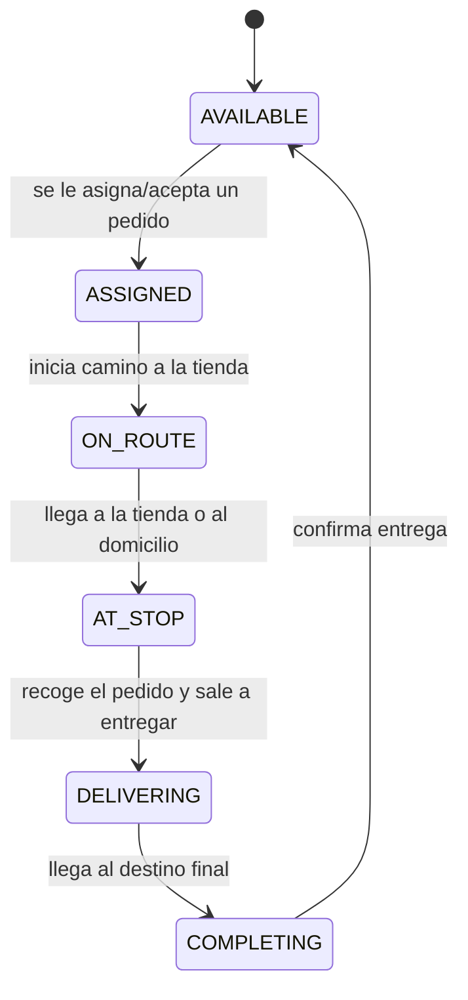
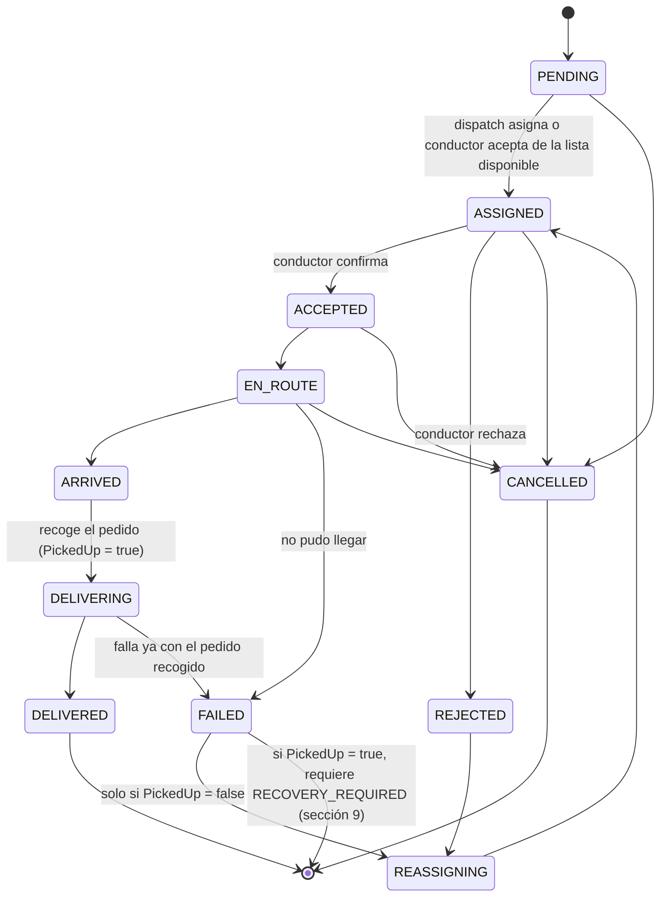

# Especificación de Logística de Repartidores

Este documento formaliza el análisis en [`Delivery logistics.md`](./Delivery%20logistics.md) como un contrato de implementación. Es la referencia que debe seguir cualquier trabajo futuro sobre el módulo de pedidos y repartidores en TenjoMicilios.

Principio rector (de las notas originales): **no diseñamos alrededor de "cada X segundos mando GPS"**. Diseñamos alrededor de **eventos + estado + sincronización**, porque en Tenjo la conectividad rural no está garantizada.

---

## 1. Alcance de este documento

Cubre: máquinas de estado (conductor, pedido, conexión, batería), modelo de eventos, sincronización offline, resolución de conflictos, reglas de reasignación, modelo de datos, arquitectura de referencia, escenarios de falla y casos de prueba.

**No cubre todavía** (fuera de alcance, se define cuando se necesite): scoring multi-factor real para el `DispatchService` (ETA con tráfico, zonas, capacidad de vehículo), integración con proveedor de mapas para ruteo, notificaciones push, SignalR en tiempo real. Estas piezas están mencionadas como destino final, no como requisito inmediato.

La sección 14 (**Fases de implementación**) es la que responde "qué construimos ya vs. qué queda documentado para después". Todo lo anterior a esa sección describe el sistema completo tal como debe terminar, no lo que se construye hoy.

---

## 2. Principio fundamental: dos fuentes de verdad

- **Servidor:** verdad operacional y de negocio.
- **Teléfono:** verdad temporal/local mientras está desconectado.

```
Con conexión:          Sin conexión:              Al reconectar:
Teléfono                Teléfono                   Teléfono
   ⇅                       │                           │ eventos pendientes
Servidor                   ├── GPS                     ▼
                           ├── estado del pedido     Servidor
                           ├── eventos                  ├── valida
                           └── cola de sincronización   ├── ordena
                                                         ├── resuelve conflictos
                                                         └── confirma
```

La app nunca depende de Internet para saber qué está haciendo el conductor *en ese momento* — eso vive en el teléfono primero.

---

## 3. Modelo de datos

### Driver (conductor)
| Campo | Tipo | Notas |
|---|---|---|
| Id | int | |
| Name | string | |
| Status | enum `DriverStatus` | ver sección 4 |
| ConnectionStatus | enum `ONLINE`/`OFFLINE` | independiente de `Status` |
| GpsStatus | enum `AVAILABLE`/`UNAVAILABLE`/`DEGRADED` | independiente de `Status` |
| BatteryStatus | enum `NORMAL`/`LOW`/`VERY_LOW`/`CRITICAL` | derivado, no autoritativo |
| LastHeartbeatAt | datetime? | último contacto con el servidor |
| LastLatitude / LastLongitude | double? | última posición confirmada por el servidor |
| LastLocationAt | datetime? | |

No se mete todo en un único campo `Status` — un conductor `ON_ROUTE` + `OFFLINE` + `battery 3%` cuenta una historia distinta de `ON_ROUTE` + `ONLINE` + `battery 80%`, y las reglas de negocio (sección 9) necesitan verlas por separado.

### Order (pedido)
| Campo | Tipo | Notas |
|---|---|---|
| Id | int | |
| StoreId | int | |
| ConsumerAddressId | string? | nullable — hoy las direcciones del consumidor solo viven en el celular (`SharedPreferences`), no hay backend de consumidor todavía |
| DriverId | int? | |
| Status | enum `OrderStatus` | ver sección 5 |
| PickedUp | bool | true una vez el conductor confirma que tiene el pedido físicamente — bloquea reasignación automática (sección 9) |
| CreatedAt | datetime | |

Los timestamps por transición (`AcceptedAt`, `DeliveredAt`, etc.) **no viven como columnas sueltas en `Order`** — viven en `OrderEvent` (sección 7), que es la fuente de auditoría. `Order` solo guarda el estado actual.

### OrderEvent (cola de eventos / auditoría)
| Campo | Tipo | Notas |
|---|---|---|
| EventId | Guid | generado en el cliente, es la clave de idempotencia |
| DriverId | int | |
| OrderId | int? | null para eventos que no son de un pedido (ej. `BATTERY_LOW`) |
| EventType | string | ver catálogo en sección 7 |
| ClientTimestamp | datetime | cuándo ocurrió en el teléfono |
| ReceivedAt | datetime | cuándo lo procesó el servidor |
| Latitude / Longitude | double? | |
| Data | jsonb | payload libre según `EventType` |
| SyncStatus | enum `PENDING`/`SYNCING`/`ACKNOWLEDGED` | estado en el cliente; en el servidor un evento recibido ya es `ACKNOWLEDGED` |

### LocationSample
| Campo | Tipo | Notas |
|---|---|---|
| DriverId | int | |
| Timestamp | datetime | |
| Latitude / Longitude | double | |
| Accuracy / Speed / Heading | double? | |
| Synced | bool | |

### DeviceStatusSample (heartbeat de batería/conexión)
| Campo | Tipo | Notas |
|---|---|---|
| DriverId | int | |
| Timestamp | datetime | |
| BatteryPercentage | int | |
| BatteryState | enum `NORMAL`/`LOW`/`VERY_LOW`/`CRITICAL` | |
| Charging | bool | |
| ConnectionStatus | enum `ONLINE`/`OFFLINE` | |

---

## 4. Máquina de estados del conductor (`Driver.Status`)



`OFFLINE` **no es un estado de esta máquina** — es `ConnectionStatus`, ortogonal. Un conductor puede estar en cualquiera de estos estados y a la vez offline.

---

## 5. Máquina de estados del pedido (`Order.Status`)



Regla dura: **una vez `PickedUp = true`, el pedido ya no puede pasar automáticamente a `REASSIGNING`** — ver sección 9, caso "pedido ya recogido".

---

## 6. Conexión, GPS y batería: señales, no decisiones

`ConnectionStatus`, `GpsStatus` y `BatteryStatus` describen la salud del dispositivo. **Ninguno de los tres decide una acción de negocio por sí solo.** La decisión de reasignar, marcar `REQUIERE_ATENCION`, etc. combina varias señales a la vez (sección 9).

Batería: no se reporta cada cambio de porcentaje. Se emite un evento solo al cruzar un umbral:

- `20%` → `BATTERY_LOW`
- `10%` → `BATTERY_VERY_LOW`
- `5%` → `BATTERY_CRITICAL`

GPS: es independiente de Internet. El teléfono puede tener `GPS = AVAILABLE` y `ConnectionStatus = OFFLINE` al mismo tiempo — sigue tomando `LocationSample` y los guarda localmente para sincronizar después.

Frecuencia de muestreo de ubicación (adaptativa, para cuidar batería):

| Condición | Frecuencia |
|---|---|
| En movimiento | cada 5–10 s |
| Detenido | cada 30–60 s |
| Sin conexión | igual, pero guarda local |
| Batería crítica | reduce frecuencia |

---

## 7. Modelo de eventos

Catálogo de `EventType`:

`ORDER_ASSIGNED`, `ORDER_ACCEPTED`, `ORDER_REJECTED`, `ARRIVED`, `PICKED_UP`, `DELIVERING_STARTED`, `DELIVERED`, `ORDER_FAILED`, `LOCATION_SAMPLE`, `BATTERY_LOW`, `BATTERY_VERY_LOW`, `BATTERY_CRITICAL`, `CONNECTION_LOST`, `DEVICE_RECONNECTED`.

En vez de guardar solo `Order.Status = DELIVERED`, guardamos la secuencia completa de eventos — eso da auditoría real: quién tenía el pedido, cuándo lo aceptó, dónde estaba, cuánto tiempo estuvo offline, cuándo volvió, cuándo entregó.

### Idempotencia

Cada evento tiene `EventId` (UUID) generado en el cliente. Si el teléfono manda `DELIVERED`, se corta la conexión antes de la confirmación, y el teléfono reenvía el mismo evento (mismo `EventId`) — el servidor debe reconocer que ya lo procesó y **no** duplicar la entrega. Constraint único sobre `EventId` en la tabla `OrderEvent`; el endpoint de sincronización responde `ACKNOWLEDGED` sea la primera vez o un reintento.

---

## 8. Cola local y sincronización

El teléfono mantiene una `LocalEventQueue` (almacenamiento local, ej. SQLite/Hive). Cada acción del conductor ("llegué", "recogí el pedido", "entregué") se registra ahí primero, con `SyncStatus = PENDING`, y la UI continúa sin esperar al servidor.

```
PENDING → SYNCING → ACKNOWLEDGED
```

Al recuperar conexión: se suben los eventos pendientes en lote (`POST /api/drivers/{id}/events`, arreglo de eventos), ordenados por `ClientTimestamp`; el servidor los procesa en orden, valida transiciones contra la máquina de estados (sección 5), y confirma cada uno.

### Resolución de conflictos

El servidor es la autoridad final. Ejemplo: el cliente cancela un pedido mientras el conductor está offline y su teléfono sigue mostrando `DELIVERING`. Regla de precedencia: **el estado del servidor gana**, pero el cliente debe recibir explícitamente "el estado del pedido cambió mientras estabas desconectado" al reconectar — nunca se sobreescribe el estado local en silencio (`Mobile state = Server state` sin aviso está prohibido).

---

## 9. Reglas de reasignación

Servicio dedicado: `DispatchService`.

```
Detectar necesidad de reasignación
        ↓
Buscar candidatos
        ↓
Calcular puntuación
        ↓
Seleccionar conductor
        ↓
Bloquear pedido
        ↓
Asignar
        ↓
Notificar
```

Factores de puntuación (orden de implementación, no todos desde el día 1): `distance` (fase 1) → `ETA`, `current workload`, `driver availability`, `zone`, `vehicle capacity`, `priority` (fases posteriores) → `route impact`, `traffic`, `delivery windows`, `historical performance` (futuro).

### Motor de políticas (ejemplos formales)

```
SI conductor offline
Y pedido = ASSIGNED
Y pedido NO recogido (PickedUp = false)
Y tiempo offline > 5 minutos
ENTONCES candidato a reasignación

SI conductor offline
Y pedido = DELIVERING
Y pedido recogido (PickedUp = true)
ENTONCES NO reasignar automáticamente → RECOVERY_REQUIRED + intervención del operador

SI batería <= 5%
Y conductor sigue en movimiento
ENTONCES advertencia (REQUIERE_ATENCION), NO reasignación automática
```

**Regla dura, sin excepción:** si el pedido ya está físicamente con el conductor (`PickedUp = true`), ningún otro conductor puede recibirlo automáticamente. Pasa a `RECOVERY_REQUIRED`, que necesita intervención manual (del operador/admin), nunca del `DispatchService`.

La batería es una señal de entrada al cálculo, nunca una regla aislada tipo "batería < 5% → reasignar".

---

## 10. Arquitectura de referencia

```
┌──────────────────────────────────────┐
│         APP MÓVIL DEL REPARTIDOR      │
│ GPS · almacenamiento offline ·        │
│ cola de eventos · monitor de batería ·│
│ visualización de ruta                 │
└──────────────────┬───────────────────┘
                    │ HTTPS (hoy) / SignalR (futuro)
┌──────────────────▼───────────────────┐
│               BACKEND                 │
│ Order Service · Driver Service ·      │
│ Tracking Service · Dispatch Engine ·  │
│ Synchronization Service ·             │
│ Notification Service                  │
└──────────────────┬───────────────────┘
┌──────────────────▼───────────────────┐
│              BASE DE DATOS            │
│ Drivers · Orders · Assignments ·      │
│ Events · Locations · DeviceStatus ·   │
│ AuditLog                              │
└────────────────────────────────────────┘
```

Mapeo a la arquitectura por capas ya existente en `TenjoMovil.Api` ([backend/TenjoMovil.Api/ARCHITECTURE.md](../backend/TenjoMovil.Api/ARCHITECTURE.md)):

| Pieza del diagrama | Dónde vive en nuestra arquitectura |
|---|---|
| Order Service, Driver Service | `Domains/Orders/*`, `Domains/Drivers/*` — una clase por caso de uso, igual que hoy |
| Tracking Service | `Domains/Drivers/UpdateDriverLocationDomain` + `LocationSample` (nuevo) |
| Dispatch Engine | `Domains/Orders/*` que implementen las reglas de la sección 9, cuando se construyan |
| Synchronization Service | Nuevo endpoint `POST /api/drivers/{id}/events`, domain que valida idempotencia y transiciones |
| Notification Service | Futuro — Firebase/SignalR, no existe todavía |
| Events, Locations, DeviceStatus, AuditLog | Nuevas tablas EF Core: `OrderEvent`, `LocationSample`, `DeviceStatusSample` |

El proveedor de mapas (OpenStreetMap hoy, Mapbox/Google Maps como alternativas ya evaluadas en `projectdescription_es.md`) queda desacoplado de esta lógica de negocio — solo se usa para mostrar el mapa y, más adelante, calcular rutas.

---

## 11. Escenarios de falla y comportamiento esperado

| # | Escenario | Comportamiento esperado |
|---|---|---|
| 1 | Offline 6 min, batería 80%, GPS activo, pedido `EN_ROUTE`, en movimiento | No reasignar. Todo normal, solo falta conexión. |
| 2 | Offline 8 min, batería 3%, última posición conocida, pedido `EN_ROUTE` | Marcar `REQUIERE_ATENCION`. Todavía no reasignar. |
| 3 | Offline 20 min, batería 2%, pedido `ASSIGNED`, no recogido | Reasignación automática permitida según política. |
| 4 | Batería baja hasta apagado (`4%→3%→2%→OFF`), luego silencio total | Servidor recibió `BATTERY_CRITICAL`, después deja de recibir heartbeat. Se infiere `possibleCause = LOW_BATTERY`, se guarda `lastHeartbeat`/`lastKnownBattery`/`connectionLost`. **Nunca se afirma como hecho confirmado** que el teléfono se apagó. |
| 5 | Reconexión tras corte largo | Evento `DEVICE_RECONNECTED`; la app sincroniza la cola pendiente en orden. |
| 6 | Reintento de un evento ya procesado (`DELIVERED` duplicado por corte de red) | Servidor detecta `EventId` repetido, responde `ACKNOWLEDGED` sin duplicar la entrega. |
| 7 | Pedido `DELIVERING` (ya recogido) y conductor offline | No reasignar. Pasa a `RECOVERY_REQUIRED`, requiere intervención del operador. |
| 8 | Cliente cancela mientras conductor está offline mostrando `DELIVERING` | Al reconectar, servidor informa explícitamente el cambio de estado; el cliente reconcilia, no se sobreescribe en silencio. |
| 9 | GPS perdido pero Internet funciona | `GpsStatus = UNAVAILABLE`, `ConnectionStatus = ONLINE` — se sigue permitiendo sincronizar eventos aunque no haya `LocationSample` nuevas. |
| 10 | Batería baja pero conductor detenido (sin movimiento) | Señal registrada, sin acción automática — se combina con "sin movimiento" antes de decidir cualquier cosa. |
| 11 | Conductor rechaza un pedido `ASSIGNED` | Pasa a `REJECTED` → `REASSIGNING` → se busca otro candidato. |
| 12 | Dos conductores intentan aceptar el mismo pedido `PENDING` casi simultáneamente (condición de carrera) | El servidor debe aceptar solo al primero que llega (transacción/lock a nivel de fila), el segundo recibe un error explícito de "pedido ya no disponible", no un 500 genérico. |

---

## 12. Casos de prueba a implementar

- Aceptar un pedido `PENDING` sin conductor asignado → pasa a `ASSIGNED`/`ACCEPTED`, `DriverId` queda seteado.
- Un conductor con un pedido activo (`ACCEPTED`/`EN_ROUTE`/`DELIVERING`) intenta aceptar otro → rechazado explícitamente, no debe quedar en un estado inconsistente.
- Dos requests concurrentes intentando aceptar el mismo pedido `PENDING` → solo uno gana (ver escenario 12).
- Reenviar el mismo `EventId` dos veces → el segundo no genera efectos duplicados, ambos responden `ACKNOWLEDGED`.
- Pedido `FAILED` con `PickedUp = false` → puede pasar a `REASSIGNING`.
- Pedido `FAILED`/offline con `PickedUp = true` → **no** puede pasar a `REASSIGNING` automáticamente, debe quedar en `RECOVERY_REQUIRED`.
- Cancelar un pedido mientras el conductor asignado está offline → al reconectar, el conductor recibe la notificación de cambio de estado, no puede seguir avanzando el pedido cancelado.
- Cruce de umbral de batería (`21%→19%`) → genera exactamente un evento `BATTERY_LOW`, no un evento por cada punto porcentual.
- Listar pedidos disponibles para un conductor sin ubicación conocida de alguna tienda → esa tienda no rompe el orden, queda al final (o se excluye) en vez de fallar el cálculo de distancia.

---

## 13. Glosario rápido

- **Dispatch:** proceso de decidir qué conductor recibe qué pedido.
- **Evento vs. estado:** el estado es "dónde está ahora"; el evento es "qué pasó" — el historial de eventos reconstruye el estado, no al revés.
- **Idempotente:** procesar el mismo evento una o cien veces produce el mismo resultado.
- **Fuente de verdad:** quién decide el valor correcto cuando servidor y teléfono no coinciden (siempre el servidor, con aviso al cliente).

---

## 14. Fases de implementación

Este es el plan que traduce todo lo anterior en pasos concretos, del más simple al más completo. Cada fase es funcional por sí sola — no se necesita completar una fase futura para que la anterior sirva en producción a la escala de Tenjo.

### Fase 1 — MVP online-only (siguiente paso inmediato)
- `Order` con 3 estados prácticos: `Pendiente` (= `PENDING`), `Aceptado` (colapsa `ASSIGNED`+`ACCEPTED`+`EN_ROUTE`+`ARRIVED` en uno solo), `Entregado` (= `DELIVERED`). Se usan estos nombres reducidos a propósito para no implementar transiciones que todavía no tienen UI detrás.
- Sin `OrderEvent`, sin cola offline, sin batería/heartbeat, sin `DispatchService` automático.
- El repartidor ve pedidos `Pendiente` ordenados por cercanía (Haversine, igual que ya se usa para el radio de cobertura del consumidor), usando su GPS real vía HTTP directo.
- Acepta manualmente un pedido; el backend valida que no tenga otro pedido activo (regla dura, sin excepciones todavía).
- El restaurante crea pedidos manualmente (todavía no hay carrito de consumidor) desde una pantalla mínima.
- Diseño de nombres/columnas ya compatible con las fases siguientes (ej. campo `PickedUp` reservado aunque no se use aún en la UI).

### Fase 2 — Auditoría con eventos (todavía online-required)
- Se introduce `OrderEvent` para registrar cada transición con `EventId`, sin cola offline todavía — el cliente llama directo al confirmar cada paso.
- Historial completo por pedido consultable (quién, cuándo, desde dónde).

### Fase 3 — Cola local y sincronización offline
- `LocalEventQueue` en el teléfono, `SyncStatus`, envío en lote al reconectar, endpoint `POST /api/drivers/{id}/events`.
- Resolución de conflictos servidor-gana-pero-avisa (sección 8).

### Fase 4 — Señales de dispositivo
- `LocationSample` con frecuencia adaptativa, `DeviceStatusSample` (batería/conexión), eventos de umbral (`BATTERY_LOW`/`VERY_LOW`/`CRITICAL`).
- Reasignación automática controlada por el motor de políticas (sección 9), respetando la regla dura de `PickedUp`.

### Fase 5 — Dispatch inteligente
- `DispatchService` con scoring multi-factor (ETA, carga de trabajo, zona, capacidad, prioridad), integración de ruteo con proveedor de mapas.

---

*Este documento formaliza [`Delivery logistics.md`](./Delivery%20logistics.md). Cualquier cambio de fondo a las reglas aquí descritas debe reflejarse en ambos archivos.*
