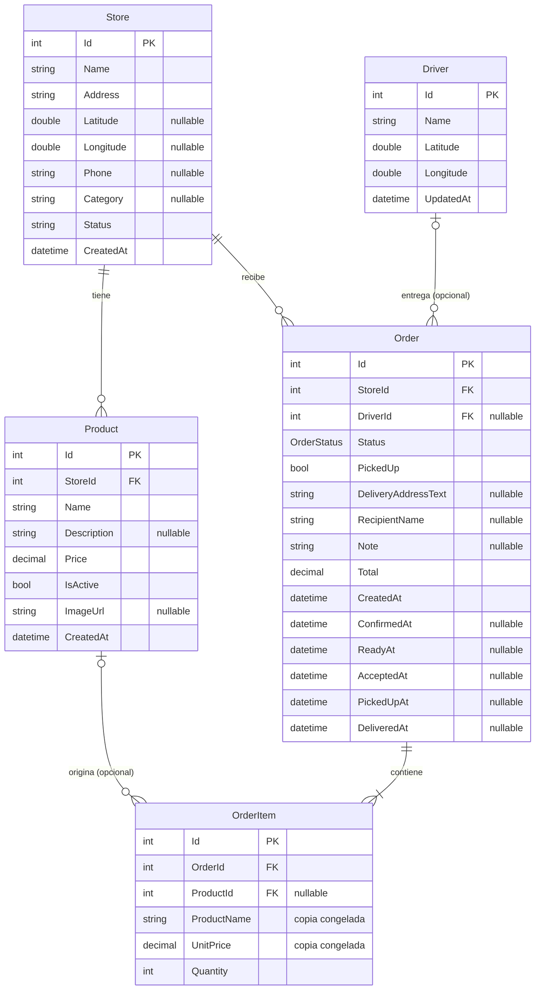
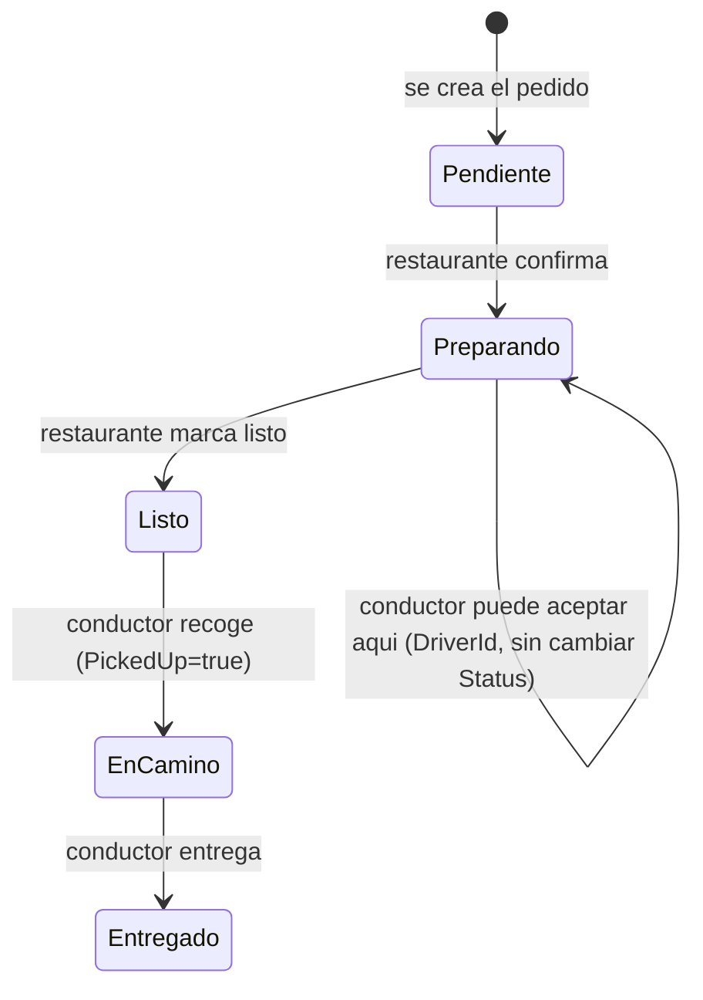

# Modelo de Datos y Relaciones

Referencia del esquema actual del backend (`TenjoMovil.Api`, PostgreSQL vía EF Core). Documenta lo que existe hoy en `Entities/` — no es un plan a futuro, es el estado real del código. Actualizar este archivo cada vez que el esquema cambie.

Para el ciclo de vida completo de un pedido (estados, eventos, sincronizacion offline), ver [especificacion-logistica-repartidores.md](./especificacion-logistica-repartidores.md). Este documento se enfoca solo en la estructura de datos, no en el comportamiento.

---

## Diagrama de entidades

---

## Entidades

### Store (tienda)
Registrada por el admin, con o sin ubicación en el mapa (`Latitude`/`Longitude` nullable — ver "Tiendas sin ubicación registrada en el mapa" en `projectdescription_es.md`). `Status` es un string libre (`pending`, etc.), todavía no es un enum.

### Driver (conductor)
Sin login: se crea vía `POST /api/drivers { name }` (Id autogenerado) la primera vez que alguien entra como repartidor en la app, y el Id se guarda localmente en el celular (`SharedPreferences`, ver `DriverIdentityService`). `Latitude`/`Longitude` son la última posición conocida, actualizada por la app vía GPS real (`geolocator`) cada vez que el repartidor refresca su pantalla.

### Product (producto)
Catálogo por tienda. `Price` y `Name` son la fuente de verdad actual — cuando se crea un `OrderItem` se copian a ese momento (ver más abajo), así que cambiar el precio de un producto no afecta pedidos ya creados.

### Order (pedido)
La entidad central del flujo de domicilios. Dos cosas que vale la pena notar porque no son obvias leyendo solo los nombres de columna:

- **`Status` combina dos historias que en la especificación completa están separadas** (preparación del restaurante vs. asignación del conductor), simplificado para la Fase 1. Ver la máquina de estados abajo.
- **`DeliveryAddressText`/`RecipientName` son texto libre**, no una referencia a una dirección real. Las direcciones del consumidor (`ConsumerAddress`) solo existen en el celular del consumidor (`SharedPreferences`, ver `mobile/lib/core/models/consumer_address.dart`) — no hay backend de consumidor todavía, así que no hay FK posible. Cuando exista, este campo se reemplaza por una referencia real.
- **No hay entidad `Consumer` en el backend.** Hoy los pedidos los crea el restaurante manualmente (pantalla "Pedidos", eligiendo productos del catálogo) porque el carrito del consumidor no existe. `RecipientName` es lo más cercano a "quién pidió esto" que existe hoy.

#### Máquina de estados de `Order.Status`

Notas:
- Un conductor puede reclamar el pedido (`DriverId`) desde `Preparando` — no necesita esperar a `Listo`. Así puede ir llegando a la tienda mientras se prepara.
- `PickedUp`/`PickedUpAt` quedan en `true`/con fecha cuando pasa a `EnCamino`. Antes de eso, `PickedUp` es siempre `false`.
- Cada transición tiene su propio timestamp (`ConfirmedAt`, `ReadyAt`, `AcceptedAt`, `PickedUpAt`, `DeliveredAt`) en vez de un solo campo genérico — permite saber cuánto tardó cada etapa sin necesitar una tabla de eventos todavía (esa tabla, `OrderEvent`, es parte de la Fase 2 de la especificación de logística, no existe hoy).

### OrderItem (línea de pedido)
`ProductId` es **nullable** a propósito: permite un item suelto que no viene del catálogo (por ejemplo, algo que el restaurante escribe a mano). `ProductName` y `UnitPrice` son una copia congelada al momento de crear el pedido — nunca se recalculan aunque el producto cambie después. `Order.Total` se calcula una sola vez al crear el pedido (`Σ UnitPrice × Quantity`), no es una columna calculada dinámicamente.

---

## Relaciones

| Relación | Tipo | Notas |
|---|---|---|
| Store → Product | 1 a muchos | `Product.StoreId` |
| Store → Order | 1 a muchos | `Order.StoreId` |
| Driver → Order | 1 a muchos, opcional | `Order.DriverId` nullable — un pedido sin conductor asignado tiene `DriverId = null` |
| Order → OrderItem | 1 a muchos, cascada | `OrderItem.OrderId`, `ON DELETE CASCADE` — borrar un pedido borra sus items |
| Product → OrderItem | 1 a muchos, opcional | `OrderItem.ProductId` nullable — ver "item suelto" arriba |

No hay relación `Consumer → Order` porque `Consumer` no existe como entidad en el backend.

---

## Lo que falta modelar (a propósito, todavía no)

- **Consumer** / dirección del consumidor en el backend — hoy vive solo en el dispositivo.
- **OrderEvent**, **LocationSample**, **DeviceStatusSample** — tabla de auditoría por eventos, muestreo de ubicación con frecuencia adaptativa, señales de batería/conexión. Todo esto está diseñado en la especificación de logística (Fases 2-4) pero no implementado.
- Ningún tipo de autenticación/usuario — ni para consumidor, ni para repartidor, ni para dueño de tienda.
